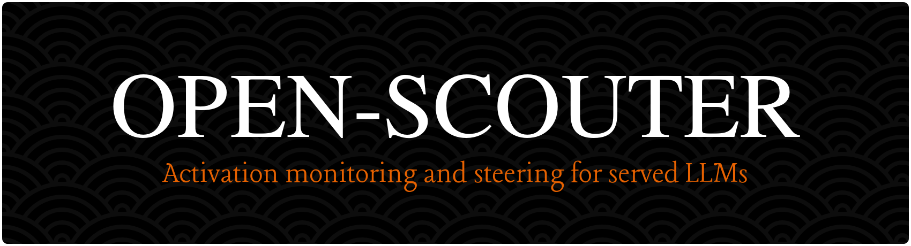

<p align="center">
  
</p>

<p align="center"><em>Read the persona, emotions and features hidden in a language model's activations, and steer them.</em></p>

<p align="center">
  <a href="https://loke-60000.github.io/open-scouter/">Docs</a> ·
  <a href="docs/install.md">Install</a> ·
  <a href="docs/usage.md">Usage</a> ·
  <a href="precomputed/gemma-4-12b/">gemma-4-12B results</a>
</p>

open-scouter serves a HuggingFace model behind an OpenAI-compatible API and
watches its residual stream while it talks. Every reply can come back with three
readings, and any of them can be turned into a steering vector without
restarting the model:

| Reading | What it tells you | Method | Based on |
|---|---|---|---|
| **Assistant axis** | How Assistant-like the persona is, and whether it drifts during the reply | Difference of means: Assistant persona vs character roles | Anthropic, [The assistant axis](https://www.anthropic.com/research/assistant-axis) ([arXiv:2601.10387](https://arxiv.org/abs/2601.10387)) |
| **Emotions** | Which of 171 emotions the text evokes | Difference of means per emotion, with neutral-text components projected out | [Emotion Concepts and their Function in a Large Language Model](https://transformer-circuits.pub/2026/emotions/index.html) |
| **Features** | Which of the model's own learned features fire, labelled by the tokens they fire on | Sparse autoencoder (dictionary learning) at one layer | [Scaling Monosemanticity](https://transformer-circuits.pub/2024/scaling-monosemanticity/), the Golden Gate Bridge feature |

The first two use directions you choose. The third finds directions the model
uses on its own, so you can discover a concept first and steer it second.
open-scouter builds all three from any HuggingFace model, so precomputed files
are optional.

## Quickstart

You need a GPU for serving (vLLM with IBM's vLLM-Hook plugin). Building
vectors works on CPU.

```bash
git clone --recurse-submodules https://github.com/Loke-60000/open-scouter
cd open-scouter
docker compose -f docker/docker-compose.yml up vllm
# or use the prebuilt image: docker pull ghcr.io/loke-60000/open-scouter:latest
```

Qwen3-0.6B ships with a precomputed assistant axis, so monitoring works right away:

```bash
SCOUTER_MODEL=Qwen/Qwen3-0.6B \
SCOUTER_AXIS=precomputed/qwen3-0.6b/axis.npz \
scouter
```

Ask for a monitored reply. Any OpenAI client works, and the extra fields are ignored by clients that do not know them.

```bash
curl -s localhost:8000/v1/chat/completions -H 'content-type: application/json' -d '{
  "messages": [{"role": "user", "content": "Pretend to be a pirate ghost."}],
  "monitor": true
}'
```

```jsonc
{
  "choices": [{"message": {"role": "assistant", "content": "Arr, ye dare disturb..."}}],
  "axis_monitor":    {"layer": 14, "mean": -3.1, "drift": -0.08, "scores": [...]},
  "emotion_monitor": {"playful": 4.2, "mischievous": 3.9, ...},   // with SCOUTER_EMOTIONS
  "feature_monitor": [{"index": 812, "label": "ye / arr / matey", "activation": 5.1}, ...]  // with SCOUTER_FEATURES
}
```

A lower `mean` is less Assistant-like, and a negative `drift` means the persona
moved away from the Assistant during the reply. The values above only show the
shape of the response.

Steer at runtime. The change applies to the next request.

```bash
# push toward the Assistant persona
curl -X POST localhost:8000/v1/steering -H 'content-type: application/json' \
  -d '{"mode": "addition", "coefficient": 8.0}'

# or cap how far the persona can drift, the capability-preserving option
curl -X POST localhost:8000/v1/steering -H 'content-type: application/json' \
  -d '{"mode": "capping", "cap_threshold": 5.0}'
```

## Build vectors for your model

```bash
pip install -e ".[generate]"     # add bitsandbytes for --load-in-4bit

scouter-generate --model <model> --out axis.npz
scouter-emotions --model <model> --out emotions.npz --emotions inputs/emotions.json
scouter-features --model <model> --out features.npz --corpus inputs/emotions.json
```

| Command | Output | Notes |
|---|---|---|
| `scouter-generate` | `axis.npz` | Separates cleanly even at 0.6B. Published axes load with `hf:qwen-3-32b`, `hf:gemma-2-27b` or `hf:llama-3.3-70b`. |
| `scouter-emotions` | `emotions.npz` | Fine-grained emotions need a capable model. The 171-emotion set does not separate at 0.6B. |
| `scouter-features` | `features.npz` and `features.npz.examples.json` | Prints the strongest features. The examples file holds each feature's top tokens in context, for checking or relabelling. |

Serve with all three loaded:

```bash
SCOUTER_MODEL=<model> SCOUTER_AXIS=axis.npz \
SCOUTER_EMOTIONS=emotions.npz SCOUTER_FEATURES=features.npz scouter
```

### Steer a feature the Golden Gate way

A feature's decoder row is a direction like any other. Load it as the steering
axis and clamp it on. The server reports the coefficient that matches 10x the
feature's maximum activation, the dose Anthropic used for Golden Gate Claude.

```bash
curl localhost:8000/v1/features/812        # {"label": ..., "clamp_coefficient": 61.3}
curl -X POST localhost:8000/v1/axis -H 'content-type: application/json' \
  -d '{"spec": "feature:812"}'
curl -X POST localhost:8000/v1/steering -H 'content-type: application/json' \
  -d '{"mode": "addition", "coefficient": 61.3}'
```

The same works for emotions with `{"spec": "emotion:calm"}`.

## What we found on gemma-4-12B

[`precomputed/gemma-4-12b/`](precomputed/gemma-4-12b/) holds the axis and the
full write-ups. The model ran in 4-bit on one 24 GB GPU with paper-scale data: 1,380 personas,
240 probes, and 171 emotions with 1,200 stories each.

- **Assistant-axis steering is not a free safety lever.** Truthfulness on TruthfulQA did not move. HumanEval dropped from 87% to 77%, and the snitch rate rose from 30% to 70%. ([results](precomputed/gemma-4-12b/RESULTS_benchmarks.md))
- **Emotions move agentic behaviour more than the persona does.** Steering toward calm, or suppressing negative emotions, pushed compliance with wrongdoing from 30% to about 100%. ([results](precomputed/gemma-4-12b/RESULTS_steering_strength.md))
- **Steering with no system prompt still sets a persona.** Directions for pirates, ghosts, single named characters and individual emotions all produce recognisable voices. ([examples](precomputed/gemma-4-12b/RESULTS_steering.md))

The snitch benchmark uses 10 scenarios per point, so read the numbers as
directional. The write-ups list every caveat.

## API

| Endpoint | Purpose |
|---|---|
| `POST /v1/chat/completions` | OpenAI-compatible chat, streaming included. Add `"monitor": true` for readings. |
| `POST /v1/monitor` | Generate and return only the readings. |
| `GET` / `POST /v1/steering` | Read or change steering: `off`, `addition` or `capping`. |
| `GET` / `POST /v1/axis` | Load the steering axis from a file, `hf:<key>`, `emotion:<name>` or `feature:<index>`. |
| `GET` / `POST /v1/emotions` | Inspect or load emotion vectors. |
| `GET` / `POST /v1/features`, `GET /v1/features/{i}` | Inspect or load a feature dictionary, or look up one feature. |
| `GET /health` | Model, loaded vectors and the current steering config. |

Every setting is a `SCOUTER_*` environment variable. See
[Usage](docs/usage.md) for the full list.

## Repository layout

```
src/scouter/
  axis/         assistant axis: personas, activation extraction, generation
  emotions/     emotion vectors: catalog, build, profile
  features/     sparse-autoencoder dictionary: train, label, encode
  api/          FastAPI app, request/response schemas
  backends/     vLLM + vLLM-Hook serving, steering and activation capture
inputs/         personas, probes and emotion stories used to build vectors
precomputed/    ready-made vectors and the gemma-4-12B experiments
scripts/        benchmarks, data generation, a chat UI
third_party/    assistant-axis and vLLM-Hook as submodules
```

## Development

```bash
pip install -e ".[dev,generate]"
pytest && ruff check src tests scripts && mypy
```

## References

- Lu, Gallagher, Michala, Fish, Lindsey, *The Assistant Axis: Situating and Stabilizing the Default Persona of Language Models*, 2026. [arXiv:2601.10387](https://arxiv.org/abs/2601.10387), code in [safety-research/assistant-axis](https://github.com/safety-research/assistant-axis).
- Sofroniew, Lindsey et al., *Emotion Concepts and their Function in a Large Language Model*, 2026. [transformer-circuits.pub](https://transformer-circuits.pub/2026/emotions/index.html), [arXiv:2604.07729](https://arxiv.org/abs/2604.07729).
- Bricken et al., *Towards Monosemanticity*, 2023. [transformer-circuits.pub](https://transformer-circuits.pub/2023/monosemantic-features/).
- Templeton et al., *Scaling Monosemanticity*, 2024. [transformer-circuits.pub](https://transformer-circuits.pub/2024/scaling-monosemanticity/).
- IBM, [vLLM-Hook](https://github.com/IBM/vLLM-Hook).

## License

MIT for this repository. The submodules keep their own licenses: assistant-axis
is MIT and vLLM-Hook is Apache-2.0. See [LICENSE](LICENSE).
